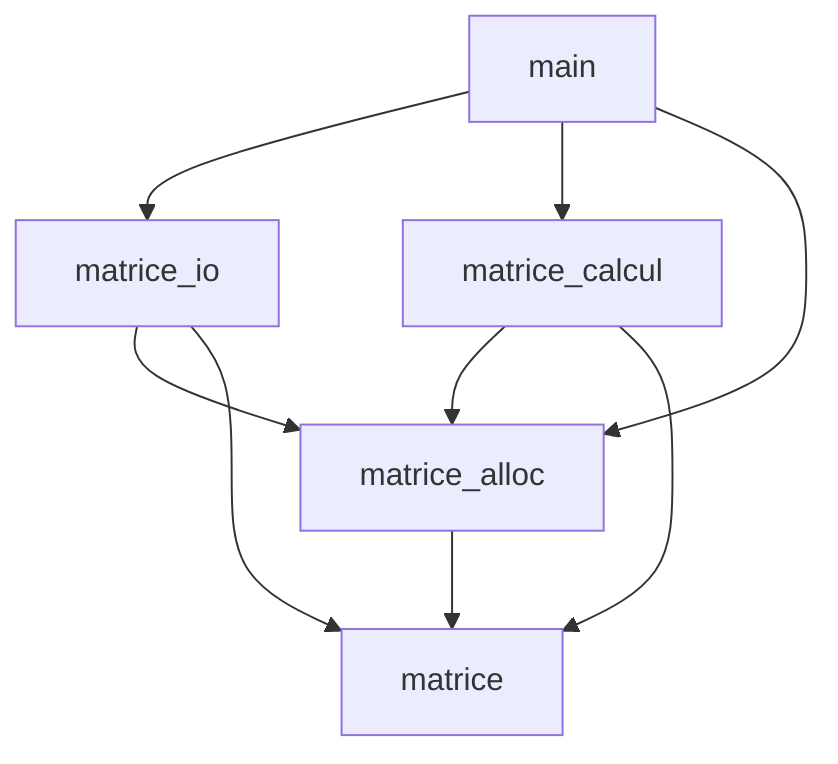
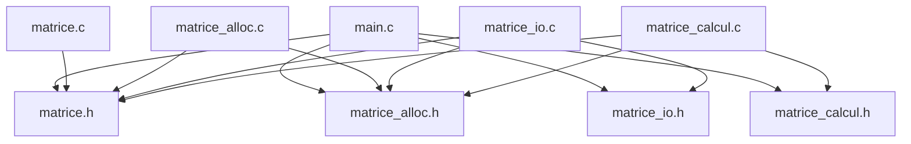
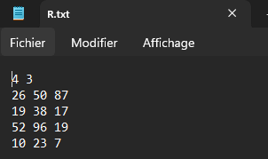
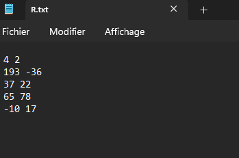
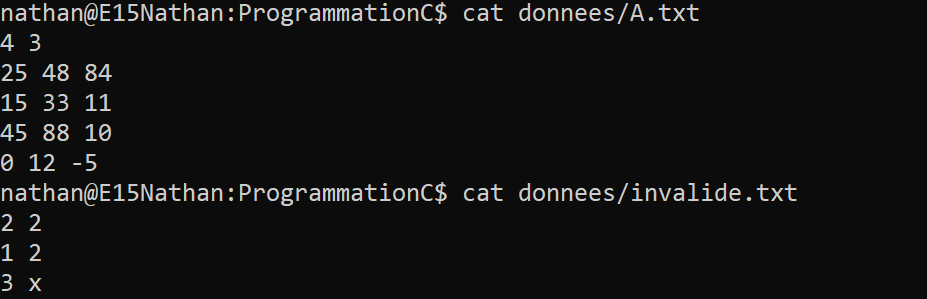

# TD Programmation C — Bibliothèque et stockage de matrices

* INSA Centre Val de Loire
* STI -- 3A
* Programmation C
* **Auteurs :** 
  * Gabin GIRODON ([@GabinGIRODON](https://github.com/GabinGIRODON))
  * Nathan BAFOUR ([@NathanBafour](https://github.com/NathanBafour))
  * Matthieu BAILS--AZAMA ([@MattB-A](https://github.com/MattB-A))
* TD2
* **Date de remise :** 2 novembre 2026

---

## Table des matières

1. [En-tête](#td-programmation-c--bibliotheque-et-stockage-de-matrices)
2. [Introduction](#2-introduction)
3. [Conception](#3-conception)
   - [3.1 Découpage modulaire et architecture](#31-decoupage-modulaire-et-architecture)
   - [3.2 Graphe des inclusions et gardes](#32-graphe-des-inclusions-et-gardes)
   - [3.3 Règles de propriété mémoire](#33-regles-de-propriete-de-la-memoire)
   - [3.4 Choix techniques et implémentation](#34-choix-techniques-et-implementation)
   - [3.5 Compilation et automatisation (Makefile)](#35-automatisation-de-la-compilation-makefile)
4. [Réalisation et validation exercice par exercice](#4-realisation-et-validation-exercice-par-exercice)
   - [4.1 Exercice 1 : Allocation et destruction](#41-exercice-1--allocation-et-destruction)
   - [4.2 Exercice 2 : Entrées-sorties](#42-exercice-2--entrees-sorties)
   - [4.3 Exercice 3 : Calcul matriciel](#43-exercice-3--calcul-matriciel)
   - [4.4 Exercice 4 : Programme principal](#44-exercice-4--demonstration-complete)
5. [Vérifications mémoire (Valgrind)](#5-verifications-memoire)
6. [Démonstration finale](#6-demonstration-finale)
   - [6.1 Scénario 1 : addition](#61-scenario-1--addition-a--b)
   - [6.2 Scénario 2 : multiplication](#62-scenario-2--multiplication-a-times-c)
   - [6.3 Scénario 3 : erreur dimensions](#63-scenario-3--scenario-derreur--addition-avec-dimensions-incompatibles-a--c)
   - [6.4 Scénario 4 : erreur fichier mal formé](#64-scenario-4--scenario-derreur---fichier-mal-forme-a-times-invalide)
7. [Bilan, difficultés et organisation](#7bilan-difficultes-et-organisation)
---

## 2. Introduction

### Contexte
L'objectif de ce TD était d'implémenter une bibliothèque modulaire en C pour manipuler et stocker des matrices avec des dimensions non imposées, tout en gérant la mémoire de façon propre.

### Objectifs du TD

Ce TD a pour objectifs :

* **Programmer proprement :** séparer les taches dans différents modules (principe de mono responsabilité), séparer les déclarations dans les en têtes (le contrat : .h) du code dans les fichiers (l'implémentation : .c), et compiler le tout proprement avec `gcc` et un `Makefile`.
* **Gérer la mémoire sans fuite :** allocution des matrices dynamique (sur le tas :`int **`), eviter toute fuite de mémoire avec `free`, en cas de réussite (fin de programme) mais aussi en cas d'erreur (avec les goto nettoyage par exemple). Vérification de la non présence de fuites avec Valgrind.
* **Manipuler les fonctions d'entrée sortie :** lecture et écriture des matrices dans des fichiers avec `fopen`, `fscanf` et `fprintf`, gestion propre des erreurs (fichiers invalides d'un point de vu du format, fichiers inexistants...)
* **Faire des calculs matriciels sécurisés :** Addition et multiplications de matrices en vérifiant la compatibilité des dimensions, prévention des débordements (type `long long`)  avant de stocker le résultat dans un `int`.
* **Gérer les erreurs :** renvoyer des codes d'erreur identiques pour chaque fonction, utiliser des tests et des workflows (github actions), ... . 

### Travail remis
À la remise du projet, nous avons mis au point tous les modules modules prévus, le makefile, et, chacun de ces modules compile sans erreur, sans avertissement, et sans fuite mémoire quelconque.

* **Exercice 1 (matrice.c, matrice_alloc.c) :** Création, destruction et vérification de la validité des opérations. Le fichier test_ex1 obtient un score de **16 / 16** et **aucune fuite mémoire détectée**.
* **Exercice 2 (matrice_io.c) :** Affichage, écriture, et lecture de matrices. Le fichier test_ex2 obtient un score de **14 / 14** et **aucune fuite mémoire détectée**.
* **Exercice 3 (matrice_calcul.c) :** Addition et produit matriciel, controle de dépassement d'entiers, controle de dimensions. La suite test_ex3 obtient un score de **14 / 14** et **aucune fuite mémoire détectée**.

* **Exercice 4 (main.c) :** Le programme demo_matrices est fonctionnel. Il répond favorablement aux scénarios proposés dans le sujet de TD (scénarios classiqes, matrices incompatibles, fichiers introuvables, fichiers mal formés, erreurs d'écriture, ...) en affichant le cas échéant l'erreur sur la sortie d'erreur stderr, et gère les codes de retour (0 en succès, 1 en échec).
* **Fuites mémoire :** Aucune fuite mémoire n'est détecté par Valgrind (All heap blocks were freed -- no leaks are possible).
* **Qualité du code :** La compilation se fait sans avertissement avec les options -std=c11 -Wall -Wextra -Wpedantic.

## 3. Conception
### 3.1 Découpage modulaire et architecture
L'architecture de ce projet repose sur une arborescence stricte et un découpage modulaire respectant le principe de responsabilité unique. L'objectif est d'isoler les concepts (types de base, allocation, calculs, tests) pour faciliter la maintenance et la compilation séparée.

### Arborescence du projet

L'ensemble des fichiers est organisé au sein du répertoire `ProgrammationC/` de la manière suivante :

```text
ProgrammationC/
├── Makefile
├── .gitignore
├── README.md
├── matrice.h / matrice.c
├── matrice_alloc.h / matrice_alloc.c
├── matrice_io.h / matrice_io.c
├── matrice_calcul.h / matrice_calcul.c
├── main.c
├── test_ex1.c
├── test_ex2.c
├── test_ex3.c
└── donnees/
    ├── A.txt
    └── ...
```
### Rôle détaillé des fichiers

*   **`matrice.h` et `matrice.c` :** 
    Module qui définit le type Matrice, la constante `MATRICE_VIDE` les codes d’erreur et les outils communs.

*   **`matrice_alloc.h` et `matrice_alloc.c` :** 
    Module qui gère la création et la déstruction d'une matrice.

*   **`matrice_io.h` et `matrice_io.c` :** 
    Module qui gère la lecture, l'écriture et l'affichage d'une matrice.

*   **`matrice_calcul.h` et `matrice_calcul.c` :** 
    Module qui effecture les calculs (addition, multiplication).

*   **`main.c` :** 
    fichier de démonstration (lit, calcule, enregistre).

*   **`test_ex1.c`, `test_ex2.c`, `test_ex3.c` :** 
    tests des exercices (fournis).

### Schéma des modules


*Figure 1 : Schéma de dépendances entre les modules*

### 3.2 Graphe des inclusions et gardes


*Figure 2 : Graphe des inclusions généré à partir des dépendances (gcc -MM)*


#### Rôle du garde `#ifndef`

Chaque fichier `.h`commence par un `#ifndef NOM_DU_FICHIER_H` et se termine par un `#endif`.

Comme le montre le graphe ci dessus, certains fichier (`main` par exemple) incluent plusieurs fichiers `.h` qui incluent eux mêmes plusieurs contrats identiques. Au moment de la compilation, le préprocesseur commence par recopier les fichiers inclus dans le corps du fichier `.c` compilé. Sans ces gardes d'inclusion, il pourrait arriver (comme dans l'exemple avec le main) que le même fichier soit recopié plusieurs fois, et la compilation échouerait ensuite. (Exemple dans `main.c`: on aurait une erreur de redéfinition de la strcuture Matrice car `main.c` inclut `matrice_io.h` et `matrice_calcul.h`, qui incluent chacun `matrice.h`).

### 3.3 Règles de propriété de la mémoire

Pour êtrte certain de l'abscence de fuites mémoires, le projet applique les sept règles suivantes :

* **R1 — Initialisation :** Toute variable de type `Matrice` est initialisée avec la constante `MATRICE_VIDE` lors de sa déclaration.
* **R2 — Responsabilité mémoire du créateur de la matrice :** Une fonction qui produit une nouvelle matrice (`mat_allouer`, `mat_lire`, `mat_additionner`, `mat_multiplier`) alloue de la mémoire dynamique. L'appellant à n'importe laquelle de ces fonctions devient donc le propriétaire de la Matrice et c'est lui qui a la responsabilité d'appeler `mat_detruire` quand il a fini de l'utiliser.
* **R3 — Nettoyage en cas d'échec :** Si une fonction échoue pendant son exécution, elle doit libérer elle-même toutes les allocations déjà effectuées et laisser la matrice de sortie dans l'état `MATRICE_VIDE`.
* **R4 — Lecture seule :** Une fonction qui reçoit une matrice constante (par valeur ou via un pointeur constant (`const Matrice *`)) ne doit pas la modifier ni libérer sa mémoire.
* **R5 — Écrasement du paramètre de sortie :** *res est un paramètre de sortie : il est écrasé sans être libéré avant (l'appelant doit donc avoir détruit son ancienne mémoire) et doit être différent des entrées.
* **R6 — Destruction :** La fonction `mat_detruire` remet la matrice à `MATRICE_VIDE`. Un deuxième appel sur la même matrice (ou un appel sur une matrice dékà à MATRICE_VIDE) est donc sans effet.
* **R7 — Gestion des flux :** Un flux est fermé par celui qui l'a ouvert. Les fonctions de `matrice_io` reçoivent un flux déjà ouvert (`FILE *`) et ne le ferment pas.

### 3.4 Choix techniques et implémentation

- **Portée des fonctions : `static` :** Les fonctions internes comme `lire_entier`, `verifier_parametres`, `tient_dans_int`, `mat_calloc` sont déclarées `static`. Elles ne sont donc visibles que dans le fichier où elles ont été écrites. Ce mot-clé permet également de définir ces fonctions comme des fonctions internes : l'utilisateur n'a besoin que de son API, et donc des fonctions déclarées dans le contrat `.h`. Les fonctions qui sont internes aux fonctions de l'API sont donc signalées comme `static`. Enfin, ce mot-clé permet d'être certain qu'uil n'y aura pas de conflit avec plusieurs fonctions du même nom (par exemple si le client a sa propre fonction `verifier_parametres`, et qu'il utilise une fonction de notre bibliothèque, il n'y aura pas d'erreur de nom avec notre fonction interne `verifier_parametres` car elle utilise le mot-clé `static`.). Ce choix isole donc la logique interne et la bibliothèque (API).

- **Gestion de l'échec partiel :**
  Une matrice de taille $n \times p$ est un tableau de pointeurs sur des entiers (`int **`). Pour allouer la mémoire, on a donc besoin de $1 + n$ allocations dynamiques : le tableau principal de pointeurs de lignes de taille $n$, et donc les $n$ allocations représentant chaque ligne (de taille $p$). Si l'allocation échoue à une ligne donnée, la fonction ne peut pas se stopper net, sans créer de fuite mémoire. 
  
  On utilise donc une boucle de nettoyage qui libère les lignes déjà obtenues, puis le tableau de pointeurs ensuite. La matrice de sortie est ensuite laissée à l'état `MATRICE_VIDE`. De cette manière l'absence de fuite mémoire est garantie.

- **Détection des dépassements d'entiers :** Le calcul de la somme et du produit entre coefficients se stocke dans un entier de type `long long`. Avant l'écriture dans la matrice, on teste si l'entier obtenu tient dans un `int` (`tient_dans_int`), pour savoir si on peut, ou non, affecter le coefficient résultant de l'addition / multiplication. Si ce n'est pas le cas, on libère la matrice en cours via `mat_detruire`, la sortie reste à `MATRICE_VIDE`, et on renvoie `MAT_ERR_DEPASSEMENT`.

### 3.5 Automatisation de la compilation (Makefile)

La compilation du projet est faite automatiquement à partir d'un `Makefile`

#### Explication
Variables de compilation:
* `CC = gcc` : compilateur C utilisé.
* `CFLAGS = -std=c11 -Wall -Wextra -Wpedantic -g` : options de compilation (avertissements stricts, etc)
* `test = -DMAT_TEST_ALLOC` : simulation des échecs mémoires.

#### Commandes disponbles

* `make` : compile le programme principal (`demo_matrices`) et tous les tests unitaires (`test_ex1`, `test_ex2`, `test_ex3`).
* `make demo_matrices` : compile le programme principal.
* `make test_ex1` : compile les tests l'exercice 1.
* `make test_ex2` : compile les tests l'exercice 2.
* `make test_ex3` : compile les tests l'exercice 3.
* `make clean` : supprime les exécutables qui ont été générés lors de l'édition de liens.

#### Contenu du Makefile

```makefile
CC = gcc
CFLAGS = -std=c11 -Wall -Wextra -Wpedantic -g
test = -DMAT_TEST_ALLOC

#Quand on fait juste "make" on les compile tous:
all: demo_matrices test_ex1 test_ex2 test_ex3

#make demo_matrices
demo_matrices: main.c matrice.c matrice_alloc.c matrice_io.c matrice_calcul.c
	$(CC) $(CFLAGS) $^ -o $@

#make test_ex1
test_ex1: test_ex1.c matrice.c matrice_alloc.c
	$(CC) $(CFLAGS) $(test) $^ -o $@

#make test_ex2
test_ex2: test_ex2.c matrice.c matrice_alloc.c matrice_io.c
	$(CC) $(CFLAGS) $(test) $^ -o $@

#make test_ex3
test_ex3: test_ex3.c matrice.c matrice_alloc.c matrice_calcul.c
	$(CC) $(CFLAGS) $(test) $^ -o $@

.PHONY: clean
#make clean
clean:
	rm -f demo_matrices test_ex1 test_ex2 test_ex3
```

#### Commande équivalente
Par exemple : La commande équivalente au `make demo_matrices` est : 
```
gcc -std=c11 -Wall -Wextra -Wpedantic -g main.c matrice.c matrice_alloc.c matrice_io.c matrice_calcul.c -o demo_matrices
```
## 4. Réalisation et validation exercice par exercice
### 4.1 Exercice 1 : Allocation et destruction

Cet exercice met en place la base du projet : structure matrice, allocation et libération sans fuite mémoire.

#### 1. Code écrit et commenté

##### Étape 1.a — `matrice.c` : Messages d'erreur
On complète le `switch` pour traduire les codes d'erreur en message compréhensible.

```c
const char *mat_message_erreur(MatErreur code)
{
    switch (code) {
    case MAT_OK:              return "succès";
    case MAT_ERR_ARGUMENT:    return "argument invalide";
    case MAT_ERR_ALLOCATION:  return "mémoire insuffisante";
    case MAT_ERR_LECTURE:     return "erreur de lecture du fichier";
    case MAT_ERR_FORMAT:      return "fichier mal formé";
    case MAT_ERR_ECRITURE:    return "erreur d'écriture du fichier";
    /* Étape 1.a */
    case MAT_ERR_DIMENSIONS:  return "dimensions incompatibles pour l'opération";
    case MAT_ERR_DEPASSEMENT: return "résultat hors de l'intervalle des int";
    default:                  break;
    }
    return "erreur inconnue";
}
```

##### Étape 1.b — `matrice.c` : Vérification de la matrice
On vérifie que le pointeur n'est pas `NULL`, que `coef` pointe bien vers une zone allouée, et que les lignes et colonnes restent dans l'intervalle autorisé.

```c
int mat_est_valide(const Matrice *m)
{
    return m != NULL
        && m->coef != NULL
        && m->nb_lignes >= 1 && m->nb_lignes <= MAT_DIM_MAX
        && m->nb_colonnes >= 1 && m->nb_colonnes <= MAT_DIM_MAX;
}
```

##### Étape 1.c — `matrice_alloc.c` : Contrôle des arguments
Avant d'allouer de la mémoire, on vérifie que les dimensions demandées sont valides.

```c
    /* Étape 1.c : vérification des bornes de taille */
    if (nb_lignes < 1 || nb_lignes > MAT_DIM_MAX || nb_colonnes < 1 || nb_colonnes > MAT_DIM_MAX)
        return MAT_ERR_ARGUMENT;
```

##### Étape 1.d — `matrice_alloc.c` : Allocation des lignes et nettoyage en cas d'échec
On alloue les `nb_lignes` tableaux de coefficients. Si une erreur survient au milieu de l'allocation, on libère les lignes déjà obtenues avant de libérer le tableau principal `coef`. (prévention des fuites mémoire)

```c
    for (int i = 0; i < nb_lignes; i++) {
        coef[i] = mat_calloc((size_t)nb_colonnes, sizeof *coef[i]);    // nb_colonnes entiers
        if (coef[i] == NULL) {
            for (int k = i - 1; k >= 0; k--)  // lignes déjà
                free(coef[k]);                // obtenues
            free(coef);                       // puis le tableau
            return MAT_ERR_ALLOCATION;
        }
    }                                                             
```

##### Étape 1.e — `matrice_alloc.c` : Remplissage de la structure résultat
Quand toutes les allocations ont réussi, on renseigne les champs de la matrice de retour et on valide avec `MAT_OK`.

```c
    res->coef = coef;
    res->nb_lignes = nb_lignes;
    res->nb_colonnes = nb_colonnes;
    return MAT_OK;
```

##### Étape 1.f — `matrice_alloc.c` : Libération avec `mat_detruire`
Si le pointeur matrice n'est pas NULL, on libère la matrice proprement : on parcourt chaque ligne pour faire un `free`, puis on libère le tableau de pointeurs `coef`. A la fin de la libération, on remet la structure à `MATRICE_VIDE`.

```c
void mat_detruire(Matrice *m)
{
    if (m == NULL)                 /* FOURNI */
        return;
        
    if (m->coef != NULL) {
        for (int i = 0; i <= (m->nb_lignes - 1); i++) {
            free(m->coef[i]);
        }
        free(m->coef);
    }

    *m = MATRICE_VIDE;   /* FOURNI : état sûr après destruction (R6) */
}
```

---

#### 2. Réponses aux questions de réflexion

- **Q3.1 Pourquoi `mat_detruire` prend-elle un `Matrice *` et non un `Matrice` ? Que se passerait-il, pour l'appelant, avec un passage par valeur ?**  
  Si on passait la structure par valeur (`Matrice m`), la fonction recevrait seulement une copie des champs. La portée de cette copie étant locale, la mémoire pointée par `coef[i]` et `coef` serait libérée, mais l'affectation `*m = MATRICE_VIDE` ne modifierait que sa propre copie locale. 
  
  Dans la fonction appelante, la variable d'origine conserverait ses pointeurs vers des adresses mémoire déjà libérées. Le pointeur ne serait alors pas `NULL`. En cas de test pour vérifier si la matrice contient des données ou non (m.coef == NULL), on croirait donc que la matrice contient des données. Dès lors, il y aurait un risque de crash du programme (`seg fault`) en cas de réutilisation de la matrice. 
  
  En passant un pointeur `Matrice *m`, on peut directement modifier la variable originale et la réinitialiser à `MATRICE_VIDE` après la libération.

- **Q3.2 Combien d'appels à `calloc` et à `free` faut-il pour une matrice $n \times p$ ? Si la $k$-ième allocation échoue, combien de libérations `mat_allouer` doit-elle effectuer ?**  
  Pour créer une matrice, il faut $1 + n$ allocations au total (1 appel pour le tableau de pointeurs de lignes `coef`, puis $n$ appels pour les lignes d'entiers). À la destruction, il faut donc $1 + n$ appels à `free` dans l'ordre inverse de l'allocation. Si la $k$-ième allocation d'une ligne échoue, alors necessairement le tableau `coef` et les $k$ premières lignes (indices $0$ à $k-1$) ont été réservés sans plantage. Il faut donc faire $k + 1$ libérations (les $k$ lignes déjà allouées avec `free(coef[...])`, et, le tableau `coef` avec `free(coef)`)

- **Q3.3 Appeler deux fois `free` sur la même adresse est un comportement indéfini. Pourquoi appeler deux fois `mat_detruire` sur la même matrice est-il sans danger ? Est-ce encore vrai si l'on a fait une copie `Matrice b = a;` puis appelé `mat_detruire(&a)` et `mat_detruire(&b)` ?**  
  Un second appel sur la même variable ne pose pas de probleme car à la fin du premier appel à `mat_detruire` la structure a déjà été remise à `MATRICE_VIDE`, donc `m->coef` est  à `NULL`. Au moment du deuxième appel, le test `if (m->coef != NULL)` est donc faux et on ne re rentre pas dans la boucle de libération (donc aucun `free` n'est executé à nouveau). 
  
  En revanche, si on fait une copie `Matrice b = a;` (donc sans utiliser notre fonction de clone), on a copié directement les champs de la strcuture. Donc, les chams a.coef et b.coef pointent au même endroit en mémoire. Si on détruit `a` avec `mat_detruire(&a)`, alors la mémoire et libérée et on met `a` à `MATRICE_VIDE`, mais `b.coef` pointe vers la zone mémoire qu'on vient de libérer. Donc, un appel à  `mat_detruire(&b)` après la libération de a, va relancer `free` sur les mêmes adresses mémoire, ce qui provoque un comportement indéfini.

- **Q3.4 Pourquoi `mat_allouer` commence-t-elle par l'affectation `*res = MATRICE_VIDE`, avant même de vérifier les dimensions ?**  
  On fait cela pour assurer la sécurité et la bonne gestion des erreurs : si la fonction échoue, la variable de sortie de l'appelant est forcément dans un état stable. Sans cette réinitialisation , si l'appelant avait par exemeple passé une variable non initialisée et que la fonction s'arrêtait pour n'importe quelle raison, `res` contiendrait des données incohérentes. Il y aurait ensuite un risque de plantage si on tentait d'appeler `mat_detruire` ou `mat_est_valide` dessus.

---

#### 3. Résultat des tests

Sortie console lors de l'exécution de `test_ex1` :

```text
=== Exercice 1 : matrice.c ===
[OK]    (1.a) message pour MAT_ERR_DIMENSIONS
[OK]    (1.a) message pour MAT_ERR_DEPASSEMENT
[OK]    (1.b) une matrice 1 x 2 est valide
[OK]    (1.b) NULL n'est pas valide
[OK]    (1.b) MATRICE_VIDE n'est pas valide
[OK]    (1.b) une matrice de 0 ligne n'est pas valide
=== Exercice 1 : matrice_alloc.c ===
[OK]    (1.c) mat_allouer refuse 0 ligne
[OK]    (1.c) mat_allouer refuse -2 colonnes
[OK]    (1.c) mat_allouer refuse une dimension > MAT_DIM_MAX
[OK]    (1.e) mat_allouer(&m, 3, 4) renvoie MAT_OK
[OK]    (1.e) m a 3 lignes et 4 colonnes
[OK]    (1.d) tous les coefficients valent 0
[OK]    (1.f) apres mat_detruire, m est vide
[OK]    (1.f) un second mat_detruire est sans danger
[OK]    (1.f) mat_detruire(NULL) ne plante pas
=== Exercice 1 : echecs d'allocation simules ===
[OK]    (1.d) chaque echec renvoie MAT_ERR_ALLOCATION et laisse *res vide

Bilan : 16 / 16 verifications reussies.

```
### 4.2 Exercice 2 : Entrées-sorties

Cet exercice porte sur les entrées et sorties : affichage sur la sortie standard, lecture depuis un flux, écriture dans un flux...

#### 1. Code écrit et commenté

##### Étape 2.a — Afficher les coefficients (`mat_afficher`)
On parcourt la matrice avec deux boucles imbriquées. Chaque entier est affiché sur 8 caractères alignés à droite (`%8d`) pour former des colonnes, et on saute une ligne à la fin de chaque rangée.

```c
    for (int i = 0; i < m->nb_lignes; i++) {
        for (int j = 0; j < m->nb_colonnes; j++)
            printf(" %8d", m->coef[i][j]);
        putchar('\n');
    }
```

##### Étape 2.b — Écrire les coefficients dans le fichier (`mat_ecrire`)
On écrit les coefficients ligne par ligne en respectant le format demandé : pas d'espace avant le premier élément (`j == 0`), un seul espace devant les suivants, as d'espace avant le saut de ligne. À chaque appel d'une fonction d'écriture dans un flux, on vérifie la valeur de retour. De cette manière, on sécurise le code, si une erreur se produit sur une de ces fonctions. 

```c
    for (int i = 0; i < m->nb_lignes; i++) {
        for (int j = 0; j < m->nb_colonnes; j++)
            if (fprintf(f, j == 0 ? "%d" : " %d", m->coef[i][j]) < 0) return MAT_ERR_ECRITURE;
        if (fputc('\n', f) == EOF)  return MAT_ERR_ECRITURE;
    }
```

##### Étape 2.c — Lire : vérifier les dimensions lues (`mat_lire`)
Les dimensions sont lues au début du flux. Si le nombre de lignes ou de colonnes est hors des bornes prévues, on renvoie une erreur de format : `MAT_ERR_FORMAT`

```c
    if (nb_lignes < 1 || nb_lignes > MAT_DIM_MAX || nb_colonnes < 1 || nb_colonnes > MAT_DIM_MAX)
        return MAT_ERR_FORMAT;
```

##### Étape 2.d — Lire : réserver une matrice locale (`mat_lire`)
On réserve la mémoire dans une matrice locale `tmp`. Si l'allocation échoue, on renvoie le code d'erreur renvoyé par `mat_allouer`.  La matrice de sortie `*res`, a déjà été initialisée à `MATRICE_VIDE` au début du code.

```c
    Matrice tmp;
    err = mat_allouer(&tmp, nb_lignes, nb_colonnes);
    if (err != MAT_OK)
        return err;
```

##### Étape 2.e — Lire : lire les coefficients (`mat_lire`)
On lit les entiers un par un grace à la fonction interne `lire_entier`. Si `lire_entier` renvoie une erreur (coeficient manquant, dépassement d'entier...): on détruit la matrice locale `tmp` avec `mat_detruire(&tmp)` puis on retourne l'erreur.

```c
    for (int i = 0; i < nb_lignes; i++) {
        for (int j = 0; j < nb_colonnes; j++) {
            err = lire_entier(f, &tmp.coef[i][j]);
            if (err != MAT_OK) {
                mat_detruire(&tmp);
                return err;
            }
        }
    }
```

##### Étape 2.f — Lire : transférer le résultat (`mat_lire`)
Une fois que tous les entiers ont été lus avec succès, on copie la structure tmp dans `*res` (`*res = tmp;`). On renovie ensuite le code de succès MAT_OK.

```c
    *res = tmp;
    return MAT_OK;
```

---

#### 2. Réponses aux questions de réflexion

- **Q4.1 Pourquoi `mat_lire` remplit-elle d'abord une matrice locale avant de l'affecter à `*res` ?**
  D'après les règles définies dans le sujet, une fonction qui échoue doit laisser la variable résultat de l'appelant dans un état stable (`MATRICE_VIDE`). Si l'on écrivait directement dans `*res`, une erreur au milieu du fichier laisserait `*res` dans un état instable (partiellement allouée), ce qui irait à l'encontre de la règle fixée. En travaillant sur la variable locale `tmp`, en cas d'erreur de lecture, `mat_lire` détruit proprement `tmp` et retourne en laissant `*res` vide.

- **Q4.2 La lecture vérifie-t-elle que chaque ligne de la matrice est sur sa propre ligne de texte ? Est-ce gênant ? Justifiez le principe « tolérant en lecture, strict en écriture ».**
  Non, `lire_entier` utilise `fscanf`. Donc, n'importe quel caractère comme espaces, tabulations, sauts de ligne, etc sera vu comme un délimiteur. Une matrice écrite sur une seule longue ligne sera donc lue sans aucune erreur. (C'est le même principe que pour le scanf classique, où le saut de ligne n'est pas obligatoire)
  
  Le principe appliqué ici est le principe de « tolérant en lecture, strict en écriture » :

   - *Tolérant en lecture* : le programme accepte des fichiers saisis à la main ou mis en forme arbitrairement qui peuvent donc contenir tous types de délimiteurs. Ce qui compte, c'est que les valeurs soient valides.
   - *Strict en écriture* : le programme génère un format canonique standardisé (un seul espace, pas d'esace en fin de ligne, ..., ) pour le traitement plus simple par la suite.

- **Q4.3 Après l'appel `mat_lire(f, &m)`, le flux `f` est positionné après le dernier coefficient. Comment exploiter cette propriété pour stocker deux matrices dans un même fichier ?**
  Comme `mat_lire` ne ferme pas le flux et s'arrête après le dernier entier de la matrice, le curseur du fichier est placé sur l'octet suivant. Pour enregistrer deux matrices dans un même fichier, il faut donc les écrire l'une après l'autre à la suite, c'est à dire appeler deux fois  `mat_ecrire` avec des matrices différentes mais le même flux. Pour les lire, on applique le même systeme mais avec `mat_lire`.

- **Q4.4 Pourquoi `mat_ecrire` appelle-t-elle `fflush` avant de renvoyer `MAT_OK` ? Cela dispense-t-il l'appelant de tester `fclose` ?**
  Quand on utilise une fonction d'entrée sortie sur un flux, les données sont stockées dans un buffer qui se vide quand il est plein. En appelant `fflush`, on force ce buffer à envoyer ses données au système, donc, en cas d'erreur, elle sera détectée plus tot et on peut renvoyer MAT_ERR_ECRITURE`.

  L'appelant doit quand même tester `fclose` car les données ne sont écrite définitivemen qu'une fois le flux fermé.

---

#### 3. Résultat des tests

Sortie obtenue à l'exécution de `test_ex2` :

```text
=== Exercice 2 : affichage (verification visuelle) ===
M (4 x 3) :
        1        2        3
        4        5        6
        7        8        9
       10       11       12
(2.a) Vous devez voir ci-dessus 4 lignes : 1 2 3 / 4 5 6 / 7 8 9 / 10 11 12
=== Exercice 2 : ecriture ===
[OK]    ouverture de test_ex2_sortie.txt en ecriture
[OK]    (2.b) mat_ecrire renvoie MAT_OK
[OK]    (2.b) le fichier contient exactement le format attendu
[OK]    (2.b) mat_ecrire refuse une matrice vide
=== Exercice 2 : relecture ===
[OK]    (2.f) mat_lire relit le fichier : MAT_OK
[OK]    (2.e) la matrice relue est identique
[OK]    (2.e) espaces et sauts de ligne en trop sont toleres
=== Exercice 2 : fichiers incorrects ===
[OK]    (2.c) fichier vide
[OK]    (2.c) dimension nulle
[OK]    (2.c) dimension negative
[OK]    (2.e) coefficient manquant
[OK]    (2.e) donnee non numerique
[OK]    (2.e) entier trop grand pour un int
=== Exercice 2 : echec d'allocation simule ===
[OK]    (2.d) mat_lire renvoie MAT_ERR_ALLOCATION proprement

Bilan : 14 / 14 verifications reussies.
```

### 4.3 Exercice 3 : Calcul matriciel

Cet exercice porte sur la mise en place des opérations supportées sur les matrices : l'addition et la multiplication. Les fonctions implémentées permettent d'additionner et de multiplier des matrices, en vérifiant la compatibilité des dimensions et en évitant les dépassements d'entiers.

#### 1. Code écrit et commenté

##### Étape 3.a — Addition : contrôler les dimensions (`mat_additionner`)
L'addition matricielle nécessite que les deux matrices soient aux mêmes dimensions. Si on tente d'additionner des matrices de dimensions différentes, on retourne donc une erreur.

```c
    if (a->nb_lignes != b->nb_lignes || a->nb_colonnes != b->nb_colonnes)
        return MAT_ERR_DIMENSIONS;
```

##### Étape 3.b — Addition : réserver le résultat (`mat_additionner`)
La matrice résultat `r` est locale et initialisée selon la taille de `a`. Si l'allocation échoue, on retourne une erreur sans toucher à `*res`.

```c
    err = mat_allouer(&r, a->nb_lignes, a->nb_colonnes);
    if (err != MAT_OK)
        return err;
```

##### Étape 3.c — Addition : calculer chaque coefficient (`mat_additionner`)
On additionne les coefficients $(i, j)$ avec un transtypage vers  `long long`. De cette manière, si l'addition entraine un débordement, on libère immédiatement la mémoire allouée à `r` avant de sortir de la fonction en retournant l'erreur de dépassement d'entier, sans tronquer le résultat (et donc obtenir un résultat faux).

```c
    long long s = (long long)a->coef[i][j] + b->coef[i][j];
    if (!tient_dans_int(s)) {
        mat_detruire(&r);
        return MAT_ERR_DEPASSEMENT;
    }
    r.coef[i][j] = (int)s;
```

##### Étape 3.d — Addition : transférer le résultat (`mat_additionner`)
Quand tous les coefficients ont été calculés, on transfère le resultat à la matrice de sortie `*res`

```c
    *res = r;
    return MAT_OK;
```

##### Étape 3.e — Multiplication : contrôler les dimensions (`mat_multiplier`)
Le produit $A \times B$ n'est possible que si le nombre de colonnes de la première matrice est égal au nombre de lignes de la deuxieme matrice. On gère donc les éventuelles erreurs.

```c
    if (a->nb_colonnes != b->nb_lignes)
        return MAT_ERR_DIMENSIONS;
```

##### Étape 3.f — Multiplication : réserver le résultat (`mat_multiplier`)
Pour un produit entre deux matrices compatibles : $(n \times p) \times (p \times q)$, la matrice produite possède $n$ lignes et $q$ colonnes. On initialise donc la matrice résultat locale $r$ aux dimensions `(a->nb_lignes, b->nb_colonnes)`.

```c
    err = mat_allouer(&r, a->nb_lignes, b->nb_colonnes);
    if (err != MAT_OK)
        return err;
```

##### Étape 3.g — Multiplication : la somme des produits (`mat_multiplier`)
On calcule chaque coefficient. Le produit intermédiaire est calculé en `long long`, comme pour l'addition. On vérifie ensuite deux choses : 

* ajouter ce produit au résultat intermédiaire n'entraine pas de dépassement de capacité sur `long long` 
* la somme finale tient bien dans un `int`. 

En cas de débordement, on détruit $r$.

```c
    for (int k = 0; k < a->nb_colonnes; k++) {
        long long p = (long long)a->coef[i][k] * b->coef[k][j];
        if ((p > 0 && s > LLONG_MAX - p)
            || (p < 0 && s < LLONG_MIN - p)) {
            mat_detruire(&r);
            return MAT_ERR_DEPASSEMENT;
        }
        s += p;
    }

    if (!tient_dans_int(s)) {
        mat_detruire(&r);
        return MAT_ERR_DEPASSEMENT;
    }
    r.coef[i][j] = (int)s;
```

##### Étape 3.h — Multiplication : transférer le résultat (`mat_multiplier`)
Quand tous les coefficients ont été calculés, on transfère le resultat à la matrice de sortie `*res`

```c
    *res = r;
    return MAT_OK;
```

---

#### 2. Réponses aux questions de réflexion (sujet 5.7)

- **Q5.1 Le paramètre `const Matrice *a` empêche-t-il d'écrire `a->coef[0][0] = 7;` ? Que protège exactement ce `const` ? Que faudrait-il changer pour que le compilateur refuse cette affectation ?**  
  Non, `const Matrice *a` n'empêche pas de modifier `a->coef[0][0]`. Le `const` protège la structure `Matrice` pointée par `a` (donc les champs `nb_lignes`, `nb_colonnes` et le pointeur `coef`). Mais ont peut néamoins modifier les zones vers lesquelles pointent coef. 
  
  Pour que le compilateur refuse cette affectation, il faudrait déclarer les coefficients eux memes comme étant constants : `const int **coef` (mais alors coef[i] = X serait autorisé) ou `const int * const *coef` pour interdire totalement de modifier `coef[i][j]`.

- **Q5.2 Pourquoi refuse-t-on l'appel `mat_additionner(&a, &b, &a)` alors que, mathématiquement, $a \leftarrow a+b$ a un sens ? Que se passerait-il avec notre implémentation si on l'acceptait ?**  
  On refuse cet appel pour éviter d'écraser a avant d'avoir fait le preemier calcul. En effet, si l'on passait `&a` en paramètre `res`, la fonction commencerait par réinitialiser a : `*res = MATRICE_VIDE`, ce qui rendrait `a` illisible pour les calculs (et créerait une fuite mémoire car les lignes et le tableau coef n'auraient jamais été libéré). 

- **Q5.3 Combien de multiplications d'entiers effectue `mat_multiplier` pour des matrices $n \times p$ et $p \times q$ ? Combien pour deux matrices $1000 \times 1000$ ?**  
  Avec ces dimensions pour les matrices opérandes, la matrice résultat possèdera $n \times q$ cases. Pour une case donnée, le coefficient de cette case est calculé avec $p$ multiplications. Le nombre total de multiplications scalaires est donc égal à :  
  $$\text{Nombre d'opérations} = \text{Nombre de cases de la matrice résultat} \times p = (n \times q)\times p$$  


  Pour deux matrices carrées de taille $1000 \times 1000$ ($n = p = q = 1000$), le programme réalise :  
  $$1000 \times 1000 \times 1000 = 10^9 \text{ multiplications (1 milliard de mutiplications).}$$

- **Q5.4 Pourquoi ne suffit-il pas de calculer `int s = a + b;` puis de tester `s < a` pour détecter un dépassement ?**  

Si le deuxième terme $b$ est négatif, la somme $a + b$ est forcément inférieure à $a$. La condition s < a est donc vraie sans dépassement, ce qui fausse le test.

De plus en C, le dépassement est interdit. Lors de la compilation, le compilateur peut simplifier le code pour l'optimiser. Le dépassement étant inderdit, le compilateur part du principe que ce débordement n'arrive jamais : le test `s < a` sera donc supprimé à la compilation. 

---

#### 3. Résultat des tests

Sortie console obtenue lors de l'exécution de `test_ex3` :

```text
=== Exercice 3 : addition ===
[OK]    (3.a) (2 x 3) + (3 x 2) : MAT_ERR_DIMENSIONS
[OK]    (3.d) (2 x 3) + (2 x 3) : MAT_OK
[OK]    (3.c) a + b est correct
[OK]    a et b n'ont pas ete modifiees
[OK]    (3.b) le resultat possede sa propre memoire
[OK]    (3.c) INT_MAX + 1 : MAT_ERR_DEPASSEMENT
=== Exercice 3 : multiplication ===
[OK]    (3.e) (2 x 3) x (2 x 3) : MAT_ERR_DIMENSIONS
[OK]    (3.h) (2 x 3) x (3 x 2) : MAT_OK
[OK]    (3.g) a x c = (58 64 / 139 154)
[OK]    (3.f) (3 x 2) x (2 x 3) donne une matrice 3 x 3
[OK]    a et c n'ont pas ete modifiees
[OK]    (3.g) 2 x 10^10 depasse INT_MAX : MAT_ERR_DEPASSEMENT
=== Exercice 3 : cas particuliers ===
[OK]    resultat = entree refuse, a reste intacte
[OK]    (3.f) echec d'allocation : MAT_ERR_ALLOCATION, r vide

Bilan : 14 / 14 verifications reussies.
```


### 4.4 Exercice 4 : Démonstration complète

Cet exercice assemble tous les exercices / fonctions développées pour faire la démonstration finale : `demo_matrices`. La démonstration prend ses arguments depuis le terminal, lit et initialise en mémoire les matrices $A$ et $B$ depuis des fichiers texte, fait l'opération demandée (`add` ou `mul`), affiche les matrices et le résultat si tout c'est bien passé, enregistre la matrice finale $R$ dabns un fichier texte, et libère l'intégralité de la mémoire allouée, gère les erreurs en cas d'echec...

#### 1. Code écrit et commenté

##### Étape 4.a — Affichage des matrices en entrée (`main.c`)
Une fois les deux matrices chargées sans erreur, on les affiche avec `mat_afficher` avec leurs noms : `"A"` et `"B"`.

```c
    mat_afficher("A", &a);
    mat_afficher("B", &b);
```

##### Étape 4.b — Calcul du résultat et gestion des erreurs (`main.c`)
En fonction de lopération, (mémorisée dans `addition`), on appelle `mat_additionner` ou `mat_multiplier`. En cas d'erreur, on affiche un message sur `stderr`, les dimensions des opérandes, et on saute vers la balise `nettoyage` avec `goto`.

```c
    MatErreur err = addition ? mat_additionner(&a, &b, &r)
                             : mat_multiplier(&a, &b, &r);
    if (err != MAT_OK) {
        fprintf(stderr, "Erreur calcul impossible : %s ",
                mat_message_erreur(err));
        fprintf(stderr, "(A: %d x %d, B: %d x %d)\n",
                a.nb_lignes, a.nb_colonnes,
                b.nb_lignes, b.nb_colonnes);
        goto nettoyage;
    }
```

##### Étape 4.c — Affichage de la matrice résultat (`main.c`)
On affiche la matrice obtenue $R$ et l'opération effectuée (`"R = A + B"` ou `"R = A x B"`).

```c
    const char *expression = addition ? "R = A + B" : "R = A x B";
    mat_afficher(expression, &r);
```

##### Étape 4.d — Confirmation et statut de succès (`main.c`)
Une fois la sauvegarde réussie dans le fichier texte, on envoie un message sur la sortie standard et on affecte `EXIT_SUCCESS` au statut de sortie qui sera retourné en fin de programme. 

```c
    printf("Résultat enregistré dans \"%s\".\n", argv[4]);
    statut = EXIT_SUCCESS;
```

---

#### 2. Réponses aux questions de réflexion (sujet 6.6)

- **Q6.1 Pourquoi le message d'erreur est-il affiché par `main.c` (ou ses fonctions `static`) et non par `mat_lire` ? Pensez à un programme graphique qui réutiliserait la bibliothèque.**  
  La bibliothèque est faite pour être réutilisée et elle ne doit donc pas imposer de sortie console en cas d'erreur. Elle doit simplement renvoyer un code d'erreur (ici c'est `MatErreur`) pour laisser la liberté à l'appellant (le client qui se sert de notre API) sur la manière dont il doit réagir. 
  
  Par exemple, si la bibliothèque était intégrée dans une application avec un GUI, afficher du texte en terminal ne serait pas utile. En revanche, l'application peut récupérer le code d'erreur et afficher un message en popup personnalisé en fonction de l'erreur dans l'interface graphique.

- **Q6.2 Pourquoi le résultat de `fclose` est-il testé dans `sauvegarder` mais pas dans `charger` ?**  
  Sauvegarder est une fonction en écriture alors que charger est une fonction en lecture.

  Les données qu'on écrit avec `fprintf` passent par un buffer. Comme évoqué précédemment, c'est à la fermeture du flux (avec `fclose`) que le système essaie d'écrire définitivement ces données : si il y a une erreur c'est donc `fclose` renverra une erreur. 

  En lecture, une fois que les données sont en mémoire, `fclose` libère juste la mémoire : même si `fclose` échouait, le contenu déjà extrait en mémoire reste valide et utilisable.

- **Q6.3 Dans le scénario 8, le calcul a réussi mais l'enregistrement a échoué. Combien de matrices faut-il libérer ? Vérifiez que votre programme le fait.**  
  Il faut libérer les 3 matrices : $A$, $B$ et $R$. On libère les matrices au niveau du label `nettoyage:` vers lequel on saute en cas d'erreur dans `sauvegarder`. A cette étape, les variables `a`, `b` et `r` sont déjà allouées, donc on appelle `mat_detruire(&r)`, `mat_detruire(&b)` et `mat_detruire(&a)` pour éviter les fuites mémoires.
---

## 5. Vérifications mémoire

Pour garantir l'absence de fuite mémoire, on a testé tous les programmes avec Valgrind (option `--leak-check=full`).


---

### 5.1 Programme `test_ex1` (Allocation et destruction)

```bash
valgrind --leak-check=full ./test_ex1
```

Résultat console :
```text
==225== HEAP SUMMARY:
==225==     in use at exit: 0 bytes in 0 blocks
==225==   total heap usage: 11 allocs, 11 frees, 1,228 bytes allocated
==225== 
==225== All heap blocks were freed -- no leaks are possible
==225== 
==225== ERROR SUMMARY: 0 errors from 0 contexts (suppressed: 0 from 0)
```

---

### 5.2 Programme `test_ex2` (Entrées-sorties)

```bash
valgrind --leak-check=full ./test_ex2
```

Résultat console :
```text
==228==
==228== HEAP SUMMARY:
==228==     in use at exit: 0 bytes in 0 blocks
==228==   total heap usage: 51 allocs, 51 frees, 60,728 bytes allocated
==228==
==228== All heap blocks were freed -- no leaks are possible
==228==
==228== For lists of detected and suppressed errors, rerun with: -s
==228== ERROR SUMMARY: 0 errors from 0 contexts (suppressed: 0 from 0)
```

---

### 5.3 Programme `test_ex3` (Calcul matriciel)

```bash
valgrind --leak-check=full ./test_ex3
```

Résultat console :
```text
==229==
==229== HEAP SUMMARY:
==229==     in use at exit: 0 bytes in 0 blocks
==229==   total heap usage: 37 allocs, 37 frees, 1,412 bytes allocated
==229==
==229== All heap blocks were freed -- no leaks are possible
==229==
==229== For lists of detected and suppressed errors, rerun with: -s
==229== ERROR SUMMARY: 0 errors from 0 contexts (suppressed: 0 from 0)
```

---

### 5.4 Programme `demo_matrices` : scénario nominal

Scénartio testé : addition valide des matrices A et B :
```bash
valgrind --leak-check=full ./demo_matrices add donnees/A.txt donnees/B.txt R.txt
```

Résultat console :
```text
==230==
==230== HEAP SUMMARY:
==230==     in use at exit: 0 bytes in 0 blocks
==230==   total heap usage: 22 allocs, 22 frees, 14,968 bytes allocated
==230==
==230== All heap blocks were freed -- no leaks are possible
==230==
==230== For lists of detected and suppressed errors, rerun with: -s
==230== ERROR SUMMARY: 0 errors from 0 contexts (suppressed: 0 from 0)
```

---

### 5.5 Programme `demo_matrices` : scénario d'erreur

Le scénario d'erreur testé ici est un tentative d'addition avec dimensions incompatibles entre A de taille 4x3 et C de taille 3x2 :
```bash
valgrind --leak-check=full ./demo_matrices add donnees/A.txt donnees/C.txt R.txt
```

Résultat console :
```text
==231==
==231== HEAP SUMMARY:
==231==     in use at exit: 0 bytes in 0 blocks
==231==   total heap usage: 14 allocs, 14 frees, 10,288 bytes allocated
==231==
==231== All heap blocks were freed -- no leaks are possible
==231==
==231== For lists of detected and suppressed errors, rerun with: -s
==231== ERROR SUMMARY: 0 errors from 0 contexts (suppressed: 0 from 0)
```
## 6. Démonstration finale

On teste ici le programme `demo_matrices` sur différents scénarios comme demandé dans le sujet. 

On a intégré au compte rendu 4 scénarios, dont 2 scénarios d'erreur.

---

### 6.1 Scénario 1 : Addition ($A + B$)

Ce test permet de valider plusieurs points : 
* lecture de deux fichiers de matrices ($4 \times 3$)
* vérification de la compatibilité des tailles
* calcul de la somme
* affichage 
* sauvegarde dans un format correct, dans un fichier de sortie

**Commande exécutée :**
```bash
./demo_matrices add donnees/A.txt donnees/B.txt R.txt
echo $?
```

**Sortie obtenue :**
```text
A (4 x 3) :
       25       48       84
       15       33       11
       45       88       10
        0       12       -5
B (4 x 3) :
        1        2        3
        4        5        6
        7        8        9
       10       11       12
R = A + B (4 x 3) :
       26       50       87
       19       38       17
       52       96       19
       10       23        7
Résultat enregistré dans "R.txt".
0
```

Le comportement est bien celui attendu : les matrices utilisées en opérandes sont affichées, tout comme résultat (qui est aussi correct), le fichier `R.txt` est bien créé et contient bien la matrice résultant de l'addition, sous la bonne forme. Le code de retour est bien 0.


---

### 6.2 Scénario 2 : Multiplication ($A \times C$)

Ce test vérifie que le produit matriciel entre une matrice $A$ de dimensions $4 \times 3$ et une matrice $C$ de dimensions $3 \times 2$ est correct. La matrice $R$ produite est  de dimensions $4 \times 2$.

Il permet, entre autres, de valider :

* la validité du programme en cas de mutliplication avec des matrices compatibles (3 colonnes pour $A$, 3 lignes pour $C$)
* l'allocation d'une matrice résultat dont les dimensions sont différetentes des deux matrices d'entrée ($4 \times 2$)
* le calcul des coefficients de la matrice résultant du produit entre deux matrices
* (comme lors du test 1) l'écriture dans le fichier R.txt, d'une nouvelle matrice, avec de nouvelles dimensions


**Commande exécutée :**
```bash
./demo_matrices mul donnees/A.txt donnees/C.txt R.txt
echo $?
```

**Sortie console :**
```text
A (4 x 3) :
       25       48       84
       15       33       11
       45       88       10
        0       12       -5
B (3 x 2) :
        1        0
        0        1
        2       -1
R = A x B (4 x 2) :
      193      -36
       37       22
       65       78
      -10       17
Résultat enregistré dans "R.txt".
0
```

Le comportement obtenu est celui attendu : le programme effectue bien le bon calcul pour trouver les coefficients corrects, produit la matrice résultat $4 \times 2$ attendue et quitte avec le code de retour `0` (donc réussite). 




### 6.3 Scénario 3 : Scénario d'erreur — Addition avec dimensions incompatibles ($A + C$)

Ce test vérifie le bon fonctionnement si on tente d'additionner la matrice $A$ ($4 \times 3$) et la matrice $C$ ($3 \times 2$). Le programme doit interdire l'opération car les dimensions sont incompatibles, renvoyer un message d'erreur sur la sortie d'erreur `stderr`, ne doit pas créer de fichier et doit retourner un code d'erreur (1).

Il permet de valider :
* la détection en cas de mauvaises dimensions pour l'addition ($4 \times 3$ et $3 \times 2$) avant de tenter des calculs
* le bon fonctionnement du systeme de message d'erreur 
* la non création / écrasement du fichier de sortie `R.txt`
* le `goto nettoyage;` qui permet de bien libérer $A$ et $B$ sans fuite mémoire
* le renvoi du code de retour `1` en cas d'erreur

**Commande exécutée :**
```bash
./demo_matrices add donnees/A.txt donnees/C.txt R.txt
echo $?
```

**Sortie obtenue :**
```text
A (4 x 3) :
       25       48       84
       15       33       11
       45       88       10
        0       12       -5
B (3 x 2) :
        1        0
        0        1
        2       -1
Erreur calcul impossible : dimensions incompatibles pour l'opération (A: 4 x 3, B: 3 x 2)
1
```

Le comportement observé est encore celui attendu : le calcul n'est pas fait car les dimensions sont incompatibles, le message d'erreur indique que l'erreur est due aux dimensions, aucun fichier n'est crée et le programme termine avec le code `1` (donc erreur).

---

### 6.4 Scénario 4 : Scénario d'erreur —  Fichier mal formé ($A \times invalide$)
Ce test nous permet de vérifier que le calcul échoue lorsque l'on essaye d'utiliser une matrice dont le format est invalide (`invalide.txt`) et que nous interrompons correctement le programme en cas d'échec de lecture.



**Commande exécutée :**
```bash
./demo_matrices add donnees/A.txt donnees/invalide.txt R.txt
echo $?
```

**Sortie obtenue :**
```text
Erreur : lecture de "donnees/invalide.txt" : fichier mal formé
1
```
Le comportement obtenu est celui attendu : nous obtenons une erreur qui correspond à `MAT_ERR_FORMAT`. Cette erreur est détectée par la fonction `lire_entier()`, puis propagée par la fonction `mat_lire()` jusqu'au programme principal.


## 7.Bilan, difficultés et organisation

### Ce que nous avons compris et difficultés rencontrées
Ce projet nous a permis de mettre en oeuvre des notions évoquées en TD (programmation modulaire, bon principes de programmation, principe de responsabilité unique, pointeurs, utilisation de la technique de l'affirmation initiale, puis des affirmations pointeurs pour décortiquer un type complexe, manipulation de flux et des focntions entrée sortie, gestion de la mémoire,  ...). 

La principale difficulté a concerné la compréhension de la notion de dépassements d'entiers, et de la méthode pour contrer ce phénomène. Nous pensions initialement qu'il suffisait d'effectuer le calcul et de comparer le résultat avec les opérandes pour vérifier s'il avait été tronqué. Nous avons compris que le dépassement sur un entier est un comportement indéfini que le compilateur optimise en supprimant le test que nous aurions alors voulu mettre en place, (et qui devient en plus faux si des valeurs sont négatives). 
Pour résoudre ce problème, la solution proposée par le sujet était d'utilsier un transtypage en `long long` puis d'ajouter un contrôle d'écrire le nouveau coefficient.

 Une seconde difficulté a été la gestion des échecs au cours de l'allocation dans `mat_allouer`, pour laquelle on désalloue toutes les lignes déjà réservées avant de libérer le tableau de pointeurs pour éviter toute fuite mémoire.

 La question de reflexion sur `const` nous a également permis de nous pencher sur son fonctionnement et sur les pointeurs plus complexes.

### Répartition du travail
- **Matthieu BAILS--AZAMA** : Exercices 2 et 3
- **Nathan BAFOUR** : Exercice 1, Makefile et rédaction du compte rendu
- **Gabin GIRODON :** Exercice 4 et rédaction du compte rendu 
- **Tous :** Relecture et compréhension de la partie des autres, et relecture totale du compte rendu.


### Aides extérieures
- **IA :** utilisé comme assistant (`man`) pour clarifier les points conceptuellement difficiles à comprendre (dépassement d'entier, compréhension des niveaux d'indirection du mot-clé `const`), pour la relecture du compte-rendu, et pour la transcription de schémas manuscrits en diagrmmes mermaid / table des matières clicable.
- **Articles & Pages WEB** : En particulier [cette page WEB sur les pièges du développement C](https://nicolasj.developpez.com/articles/pieges/) et [celle-ci pour comprendre le Makefile](https://dev.to/ashcript/comprendre-le-makefile-exemple-avec-le-langage-c-47n9)
- **Forums** : Stack Overflow et Reddit