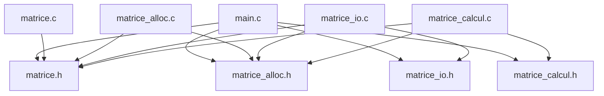

# TD Programmation C — Bibliothèque et stockage de matrices

* INSA Centre Val de Loire
* STI -- 3A
* Programmation C
* **Auteurs :** 
  * Gabin GIRODON ([@GabinGIRODON](https://github.com/GabinGIRODON))
  * Nathan BAFOUR ([@NathanBafour](https://github.com/NathanBafour))
  * Matthieu BAILS--AZAMA ([@MattB-A](https://github.com/MattB-A))
* TD2
* **Date de remise :** 2 novembre 2026

---

## Table des matières

1. [En-tête](#td-langage-c--bibliothèque-et-stockage-de-matrices)
2. [Introduction](#2-introduction)
3. [Conception](#3-conception)
   - [3.1 Découpage modulaire et architecture](#31-découpage-modulaire-et-architecture)
   - [3.2 Graphe des inclusions et gardes](#32-graphe-des-inclusions-et-gardes)
   - [3.3 Règles de propriété mémoire](#33-règles-de-propriété-mémoire)
   - [3.4 Choix techniques et implémentation](#34-choix-techniques-et-implémentation)
   - [3.5 Compilation et automatisation (Makefile)](#35-compilation-et-automatisation-makefile)
4. [Réalisation et validation exercice par exercice](#4-réalisation-et-validation-exercice-par-exercice)
   - [4.1 Exercice 1 : Allocation et destruction](#41-exercice-1--allocation-et-destruction)
   - [4.2 Exercice 2 : Entrées-sorties](#42-exercice-2--entrées-sorties)
   - [4.3 Exercice 3 : Calcul matriciel](#43-exercice-3--calcul-matriciel)
   - [4.4 Exercice 4 : Programme principal](#44-exercice-4--programme-principal)
5. [Vérifications mémoire (Valgrind)](#5-vérifications-mémoire-valgrind)
6. [Démonstration finale](#6-démonstration-finale)
7. [Bilan, difficultés et organisation](#7-bilan-difficultés-et-organisation)

---

## 2. Introduction

### Contexte
Ce TD a pour objectif de nous faire concevoir et implémenter une petite bibliothèque modulaire ayant pour but de manipuler, de stocker des matrices de dimensions variables, ainsi que d'effectuer des calculs dessus.


### Objectifs du TD

Ce TD a pour objectifs :

* **Programmer proprement :** séparer les taches dans différents modules (principe de mono responsabilité), séparer les déclarations dans les en têtes (le contrat : .h) du code dans les fichiers (l'implémentation : .c), et compiler le tout proprement avec `gcc` et un `Makefile`.
* **Gérer la mémoire sans fuite :** allocution des matrices dynamique (sur le tas :`int **`), eviter toute fuite de mémoire avec `free`, en cas de réussite (fin de programme) mais aussi en cas d'erreur (avec les goto nettoyage par exemple). Vérification de la non présence de fuites avec Valgrind.
* **Manipuler les fonctions d'entrée sortie :** lecture et écriture des matrices dans des fichiers avec `fopen`, `fscanf` et `fprintf`, gestion propre des erreurs (fichiers invalides d'un point de vu du format, fichiers inexistants...)
* **Faire des calculs matriciels sécurisés :** Addition et multiplications de matrices en vérifiant la compatibilité des dimensions, prévention des débordements (type `long long`)  avant de stocker le résultat dans un `int`.
* **Gérer les erreurs :** renvoyer des codes d'erreur identiques pour chaque fonction, utiliser des tests et des workflows (github actions), ... . 


## 3. Conception
### 3.1 Découpage modulaire et architecture
L'architecture de ce projet repose sur une arborescence stricte et un découpage modulaire respectant le principe de responsabilité unique. L'objectif est d'isoler les concepts (types de base, allocation, calculs, tests) pour faciliter la maintenance et la compilation séparée.

### Arborescence du projet

L'ensemble des fichiers est organisé au sein du répertoire `ProgrammationC/` de la manière suivante :

```text
ProgrammationC/
├── matrice.h / matrice.c
├── matrice_alloc.h / matrice_alloc.c
├── matrice_io.h / matrice_io.c
├── matrice_calcul.h / matrice_calcul.c
├── main.c
├── test_ex1.c
├── test_ex2.c
├── test_ex3.c
└── donnees/
    ├── A.txt
    └── ...
```
### Rôle détaillé des fichiers

*   **`matrice.h` et `matrice.c` :** 
    Module qui définit le type Matrice, les codes d’erreur et les outils communs.

*   **`matrice_alloc.h` et `matrice_alloc.c` :** 
    Module qui gère la création et la déstruction d'une matrice.

*   **`matrice_io.h` et `matrice_io.c` :** 
    Module qui gère la lecture, l'écriture et l'affichage d'une matrice.

*   **`matrice_calcul.h` et `matrice_calcul.c` :** 
    Module qui effecture les calculs (addition, multiplication).

*   **`main.c` :** 
    fichier de démonstration (lit, calcule, enregistre).

*   **`test_ex1.c`, `test_ex2.c`, `test_ex3.c` :** 
    tests des exercices (fournis).

### 3.2 Graphe des inclusions et gardes

*Figure 1 : Graphe des inclusions généré à partir des dépendances (gcc -MM)*
## 7.Bilan, difficultés et organisation
### Travail remis
À la remise du projet, nous avons mis au point tous les modules modules prévus, le makefile, et, chacun de ces modules compile sans erreur, sans avertissement, et sans fuite mémoire quelconque.

* **Exercice 1 (matrice.c, matrice_alloc.c) :** Création, destruction et vérification de la validité des opérations. Le fichier test_ex1 obtient un score de **16 / 16** et **aucune fuite mémoire détectée**.
* **Exercice 2 (matrice_io.c) :** Affichage, écriture, et lecture de matrices. Le fichier test_ex2 obtient un score de **14 / 14** et **aucune fuite mémoire détectée**.
* **Exercice 3 (matrice_calcul.c) :** Addition et produit matriciel, controle de dépassement d'entiers, controle de dimensions. La suite test_ex3 obtient un score de **14 / 14** et **aucune fuite mémoire détectée**.

* **Exercice 4 (main.c) :** Le programme demo_matrices est fonctionnel. Il répond favorablement aux scénarios proposés dans le sujet de TD (scénarios classiqes, matrices incompatibles, fichiers introuvables, fichiers mal formés, erreurs d'écriture, ...) en affichant le cas échéant l'erreur sur la sortie d'erreur stderr, et gère les codes de retour (0 en succès, 1 en échec).
* **Fuites mémoire :** Aucune fuite mémoire n'est détecté par Valgrind (All heap blocks were freed -- no leaks are possible).
* **Qualité du code :** La compilation se fait sans avertissement avec les options -std=c11 -Wall -Wextra -Wpedantic.