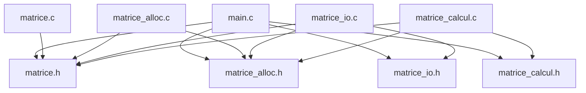

# TD Programmation C — Bibliothèque et stockage de matrices

* INSA Centre Val de Loire
* STI -- 3A
* Programmation C
* **Auteurs :** 
  * Gabin GIRODON ([@GabinGIRODON](https://github.com/GabinGIRODON))
  * Nathan BAFOUR ([@NathanBafour](https://github.com/NathanBafour))
  * Matthieu BAILS--AZAMA ([@MattB-A](https://github.com/MattB-A))
* TD2
* **Date de remise :** 2 novembre 2026

---

## Table des matières

1. [En-tête](#td-langage-c--bibliothèque-et-stockage-de-matrices)
2. [Introduction](#2-introduction)
3. [Conception](#3-conception)
   - [3.1 Découpage modulaire et architecture](#31-découpage-modulaire-et-architecture)
   - [3.2 Graphe des inclusions et gardes](#32-graphe-des-inclusions-et-gardes)
   - [3.3 Règles de propriété mémoire](#33-règles-de-propriété-mémoire)
   - [3.4 Choix techniques et implémentation](#34-choix-techniques-et-implémentation)
   - [3.5 Compilation et automatisation (Makefile)](#35-compilation-et-automatisation-makefile)
4. [Réalisation et validation exercice par exercice](#4-réalisation-et-validation-exercice-par-exercice)
   - [4.1 Exercice 1 : Allocation et destruction](#41-exercice-1--allocation-et-destruction)
   - [4.2 Exercice 2 : Entrées-sorties](#42-exercice-2--entrées-sorties)
   - [4.3 Exercice 3 : Calcul matriciel](#43-exercice-3--calcul-matriciel)
   - [4.4 Exercice 4 : Programme principal](#44-exercice-4--programme-principal)
5. [Vérifications mémoire (Valgrind)](#5-vérifications-mémoire-valgrind)
6. [Démonstration finale](#6-démonstration-finale)
7. [Bilan, difficultés et organisation](#7-bilan-difficultés-et-organisation)

---

## 2. Introduction

### Contexte
Ce TD a pour objectif de nous faire concevoir et implémenter une petite bibliothèque modulaire ayant pour but de manipuler, de stocker des matrices de dimensions variables, ainsi que d'effectuer des calculs dessus.


### Objectifs du TD

Ce TD a pour objectifs :

* **Programmer proprement :** séparer les taches dans différents modules (principe de mono responsabilité), séparer les déclarations dans les en têtes (le contrat : .h) du code dans les fichiers (l'implémentation : .c), et compiler le tout proprement avec `gcc` et un `Makefile`.
* **Gérer la mémoire sans fuite :** allocution des matrices dynamique (sur le tas :`int **`), eviter toute fuite de mémoire avec `free`, en cas de réussite (fin de programme) mais aussi en cas d'erreur (avec les goto nettoyage par exemple). Vérification de la non présence de fuites avec Valgrind.
* **Manipuler les fonctions d'entrée sortie :** lecture et écriture des matrices dans des fichiers avec `fopen`, `fscanf` et `fprintf`, gestion propre des erreurs (fichiers invalides d'un point de vu du format, fichiers inexistants...)
* **Faire des calculs matriciels sécurisés :** Addition et multiplications de matrices en vérifiant la compatibilité des dimensions, prévention des débordements (type `long long`)  avant de stocker le résultat dans un `int`.
* **Gérer les erreurs :** renvoyer des codes d'erreur identiques pour chaque fonction, utiliser des tests et des workflows (github actions), ... . 

### Travail remis
À la remise du projet, nous avons mis au point tous les modules modules prévus, le makefile, et, chacun de ces modules compile sans erreur, sans avertissement, et sans fuite mémoire quelconque.

* **Exercice 1 (matrice.c, matrice_alloc.c) :** Création, destruction et vérification de la validité des opérations. Le fichier test_ex1 obtient un score de **16 / 16** et **aucune fuite mémoire détectée**.
* **Exercice 2 (matrice_io.c) :** Affichage, écriture, et lecture de matrices. Le fichier test_ex2 obtient un score de **14 / 14** et **aucune fuite mémoire détectée**.
* **Exercice 3 (matrice_calcul.c) :** Addition et produit matriciel, controle de dépassement d'entiers, controle de dimensions. La suite test_ex3 obtient un score de **14 / 14** et **aucune fuite mémoire détectée**.

* **Exercice 4 (main.c) :** Le programme demo_matrices est fonctionnel. Il répond favorablement aux scénarios proposés dans le sujet de TD (scénarios classiqes, matrices incompatibles, fichiers introuvables, fichiers mal formés, erreurs d'écriture, ...) en affichant le cas échéant l'erreur sur la sortie d'erreur stderr, et gère les codes de retour (0 en succès, 1 en échec).
* **Fuites mémoire :** Aucune fuite mémoire n'est détecté par Valgrind (All heap blocks were freed -- no leaks are possible).
* **Qualité du code :** La compilation se fait sans avertissement avec les options -std=c11 -Wall -Wextra -Wpedantic.

## 3. Conception
### 3.1 Découpage modulaire et architecture
L'architecture de ce projet repose sur une arborescence stricte et un découpage modulaire respectant le principe de responsabilité unique. L'objectif est d'isoler les concepts (types de base, allocation, calculs, tests) pour faciliter la maintenance et la compilation séparée.

### Arborescence du projet

L'ensemble des fichiers est organisé au sein du répertoire `ProgrammationC/` de la manière suivante :

```text
ProgrammationC/
├── Makefile
├── .gitignore
├── README.md
├── matrice.h / matrice.c
├── matrice_alloc.h / matrice_alloc.c
├── matrice_io.h / matrice_io.c
├── matrice_calcul.h / matrice_calcul.c
├── main.c
├── test_ex1.c
├── test_ex2.c
├── test_ex3.c
└── donnees/
    ├── A.txt
    └── ...
```
### Rôle détaillé des fichiers

*   **`matrice.h` et `matrice.c` :** 
    Module qui définit le type Matrice, la constante `MATRICE_VIDE` les codes d’erreur et les outils communs.

*   **`matrice_alloc.h` et `matrice_alloc.c` :** 
    Module qui gère la création et la déstruction d'une matrice.

*   **`matrice_io.h` et `matrice_io.c` :** 
    Module qui gère la lecture, l'écriture et l'affichage d'une matrice.

*   **`matrice_calcul.h` et `matrice_calcul.c` :** 
    Module qui effecture les calculs (addition, multiplication).

*   **`main.c` :** 
    fichier de démonstration (lit, calcule, enregistre).

*   **`test_ex1.c`, `test_ex2.c`, `test_ex3.c` :** 
    tests des exercices (fournis).

### 3.2 Graphe des inclusions et gardes

*Figure 1 : Graphe des inclusions généré à partir des dépendances (gcc -MM)*

#### Rôle du garde `#ifndef`

Chaque fichier `.h`commence par un `#ifndef NOM_DU_FICHIER_H` et se termine par un `#endif`.

Comme le montre le graphe ci dessus, certains fichier (`main` par exemple) incluent plusieurs fichiers `.h` qui incluent eux mêmes plusieurs contrats identiques. Au moment de la compilation, le préprocesseur commence par recopier les fichiers inclus dans le corps du fichier `.c` compilé. Sans ces gardes d'inclusion, il pourrait arriver (comme dans l'exemple avec le main) que le même fichier soit recopié plusieurs fois, et la compilation échouerait ensuite. (Exemple dans `main.c`: on aurait une erreur de redéfinition de la strcuture Matrice car `main.c` inclut `matrice_io.h` et `matrice_calcul.h`, qui incluent chacun `matrice.h`).

### 3.3 Règles de propriété de la mémoire

Pour êtrte certain de l'abscence de fuites mémoires, le projet applique les sept règles suivantes :

* **R1 — Initialisation :** Toute variable de type `Matrice` est initialisée avec la constante `MATRICE_VIDE` lors de sa déclaration.
* **R2 — Responsabilité mémoire du créateur de la matrice :** Une fonction qui produit une nouvelle matrice (`mat_allouer`, `mat_lire`, `mat_additionner`, `mat_multiplier`) alloue de la mémoire dynamique. L'appellant à n'importe laquelle de ces fonctions devient donc le propriétaire de la Matrice et c'est lui qui a la responsabilité d'appeler `mat_detruire` quand il a fini de l'utiliser.
* **R3 — Nettoyage en cas d'échec :** Si une fonction échoue pendant son exécution, elle doit libérer elle-même toutes les allocations déjà effectuées et laisser la matrice de sortie dans l'état `MATRICE_VIDE`.
* **R4 — Lecture seule :** Une fonction qui reçoit une matrice constante (par valeur ou via un pointeur constant (`const Matrice *`)) ne doit pas la modifier ni libérer sa mémoire.
* **R5 — Écrasement du paramètre de sortie :** *res est un paramètre de sortie : il est écrasé sans être libéré avant (l'appelant doit donc avoir détruit son ancienne mémoire) et doit être différent des entrées.
* **R6 — Destruction :** La fonction `mat_detruire` remet la matrice à `MATRICE_VIDE`. Un deuxième appel sur la même matrice (ou un appel sur une matrice dékà à MATRICE_VIDE) est donc sans effet.
* **R7 — Gestion des flux :** Un flux est fermé par celui qui l'a ouvert. Les fonctions de `matrice_io` reçoivent un flux déjà ouvert (`FILE *`) et ne le ferment pas.

### 3.4 Choix techniques et implémentation

- **Portée des fonctions : `static` :** Les fonctions internes comme `lire_entier`, `verifier_parametres`, `tient_dans_int`, `mat_calloc` sont déclarées `static`. Elles ne sont donc visibles que dans le fichier où elles ont été écrites. Ce mot-clé permet également de définir ces fonctions comme des fonctions internes : l'utilisateur n'a besoin que de son API, et donc des fonctions déclarées dans le contrat `.h`. Les fonctions qui sont internes aux fonctions de l'API sont donc signalées comme `static`. Enfin, ce mot-clé permet d'être certain qu'uil n'y aura pas de conflit avec plusieurs fonctions du même nom (par exemple si le client a sa propre fonction `verifier_parametres`, et qu'il utilise une fonction de notre bibliothèque, il n'y aura pas d'erreur de nom avec notre fonction interne `verifier_parametres` car elle utilise le mot-clé `static`.). Ce choix isole donc la logique interne et la bibliothèque (API).

- **Gestion de l'échec partiel :**
  Une matrice de taille $n \times p$ est un tableau de pointeurs sur des entiers (`int **`). Pour allouer la mémoire, on a donc besoin de $1 + n$ allocations dynamiques : le tableau principal de pointeurs de lignes de taille $n$, et donc les $n$ allocations représentant chaque ligne (de taille $p$). Si l'allocation échoue à une ligne donnée, la fonction ne peut pas se stopper net, sans créer de fuite mémoire. 
  
  On utilise donc une boucle de nettoyage qui libère les lignes déjà obtenues, puis le tableau de pointeurs ensuite. La matrice de sortie est ensuite laissée à l'état `MATRICE_VIDE`. De cette manière l'absence de fuite mémoire est garantie.

- **Détection des dépassements d'entiers :** Le calcul de la somme et du produit entre coefficients se stocke dans un entier de type `long long`. Avant l'écriture dans la matrice, on teste si l'entier obtenu tient dans un `int` (`tient_dans_int`), pour savoir si on peut, ou non, affecter le coefficient résultant de l'addition / multiplication. Si ce n'est pas le cas, on libère la matrice en cours via `mat_detruire`, la sortie reste à `MATRICE_VIDE`, et on renvoie `MAT_ERR_DEPASSEMENT`.

### 3.5 Automatisation de la compilation (Makefile)

La compilation du projet est faite automatiquement à partir d'un `Makefile`

#### Explication

* `commande = gcc` : compilateur C utilisé.
* `flags = -std=c11 -Wall -Wextra -Wpedantic -g` : options de compilation (avertissements stricts, etc)
* `test = -DMAT_TEST_ALLOC` : simulation des échecs mémoires.

#### Commandes disponbles

* `make` : compile le programme principal (`demo_matrices`) et tous les tests unitaires (`test_ex1`, `test_ex2`, `test_ex3`).
* `make demo_matrices` : compile le programme principal.
* `make test_ex1` : compile les tests l'exercice 1.
* `make test_ex2` : compile les tests l'exercice 2.
* `make test_ex3` : compile les tests l'exercice 3.
* `make clean` : supprime les exécutables qui ont été générés lors de l'édition de liens.

#### Contenu du Makefile

```makefile
commande = gcc
flags = -std=c11 -Wall -Wextra -Wpedantic -g
test = -DMAT_TEST_ALLOC

# Quand on fait juste "make" on les compile tous :
all: demo_matrices test_ex1 test_ex2 test_ex3

# make demo_matrices
demo_matrices: main.c matrice.c matrice_alloc.c matrice_io.c matrice_calcul.c
	$(commande)$(flags) $^ -o$@

# make test_ex1
test_ex1: test_ex1.c matrice.c matrice_alloc.c
	$(commande) $(flags)$(test) $^ -o$@

# make test_ex2
test_ex2: test_ex2.c matrice.c matrice_alloc.c matrice_io.c
	$(commande) $(flags)$(test) $^ -o$@

# make test_ex3
test_ex3: test_ex3.c matrice.c matrice_alloc.c matrice_calcul.c
	$(commande) $(flags)$(test) $^ -o$@

# make clean
clean:
	rm -f demo_matrices test_ex1 test_ex2 test_ex3
```

#### Commande équivalente
Par exemple : La commande équivalente au `make demo_matrices` est : 
```
gcc -std=c11 -Wall -Wextra -Wpedantic -g main.c matrice.c matrice_alloc.c matrice_io.c matrice_calcul.c -o demo_matrices
```

## 7.Bilan, difficultés et organisation
